# Myoko Days

### Make room for Myoko.

An illustrated, green-season itinerary builder for the Myoko area. Its centrepiece is **Build**: a navigable 3D mountain landscape where places become crafted miniatures, days become a plan, and four small mountain residents reward a closer look.

Created for the SMU sustainability communication project with Patience Capital Group. The visual direction is deliberately warm, slow and tactile: a landscape to explore, rather than a wall of travel listings.

**GitHub Pages · browser-based experience · no account or booking backend**

**[Explore the live site](https://keanedt.github.io/myoko-days/) · [Open Build](https://keanedt.github.io/myoko-days/#build) · [Mountain Residents release](https://github.com/KeaneDT/myoko-days/releases/tag/v1.5.1)**

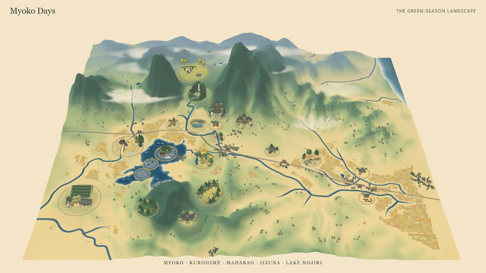

*The terrain, water, buildings, miniature activities and residents are geometry and shaders running in the browser, rather than a single flat background image.*

## From a place to a day

**Plan** sets dates, party size, walking preference and accommodation. Start from Restore, Discover or Move, or create an empty itinerary. **Build** connects exploration to decisions: inspect a miniature, read its activity, view fieldwork media, choose a day, then arrange morning and afternoon blocks. **Review** gathers the days, planning costs, written-plan download and trip film into one place.

Trip state stays in the current browser's localStorage. The prototype makes no reservations, accepts no payments and sends no booking enquiries.

## Learn by seeing a place become a day

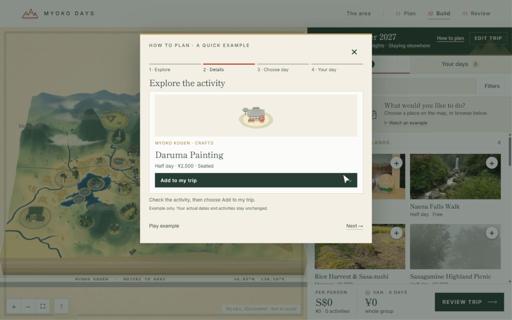

On the first visit to **Build**, a short demonstration opens in the centre of the page after the map is ready. It uses the production Daruma Painting miniature, real activity data and the same add-to-day sequence as the planner. It never edits the visitor’s trip or moves the map camera. Close at any time with the X, Escape or the backdrop; **How to plan** replays it later. The demonstration pauses at its final step instead of dismissing itself. A dark backdrop focuses attention on the centred dialog. A fixed-height stage, gently eased step transitions and persistent controls avoid layout jumps; Pause freezes both the animation and its remaining playback time.

The site has no accounts: a versioned localStorage flag remembers that the example was shown in this browser, with sessionStorage and in-memory fallbacks when storage is unavailable. There are no tracking cookies or cross-device identity checks. Clearing site data, private browsing or another browser can show it again. Reduced-motion preferences use manually advanced still frames.

The landscape keeps one planning dock: Places, activity details and Your days share the same space. Search stays visible; filters and day controls appear when needed. Adding shows a proposed day and block for confirmation, followed by a fading popup with **View day / Undo** actions. On phones the dock expands without introducing another floating map panel. Area questions jump to useful sections; Review uses natural-height day rows instead of stretching them to match the cost checklist.

Rice plots are checked in world coordinates after rotation so neighbouring field tiles do not overlap. Each plot clears the coarsest rendered terrain beneath its whole footprint on desktop and phone quality, avoiding depth shimmer from terrain poking through. The field regression checks every nearby plot pair and clips the actual terrain triangles against every plot. Map controls use translucent backgrounds while preserving solid icons and stronger hover/focus states.

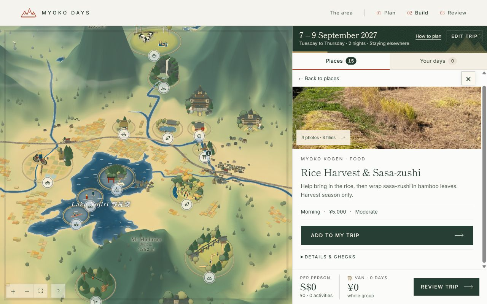

## Three ways to feel Myoko

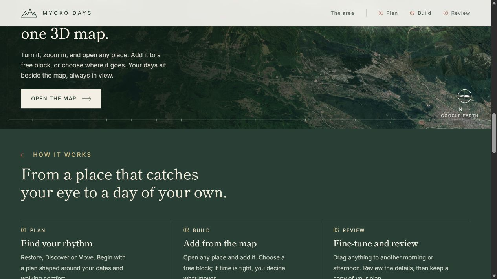

**Find your rhythm.** Slow down, follow your curiosity or head outdoors. Restore, Discover and Move are invitations to shape a trip, with every included activity shown before choosing a starting itinerary.

The home film fills the current viewport across desktop, portrait and short landscape screens, with responsive copy, safe-area spacing and a cover crop.

## Dates, prices and decisions you control

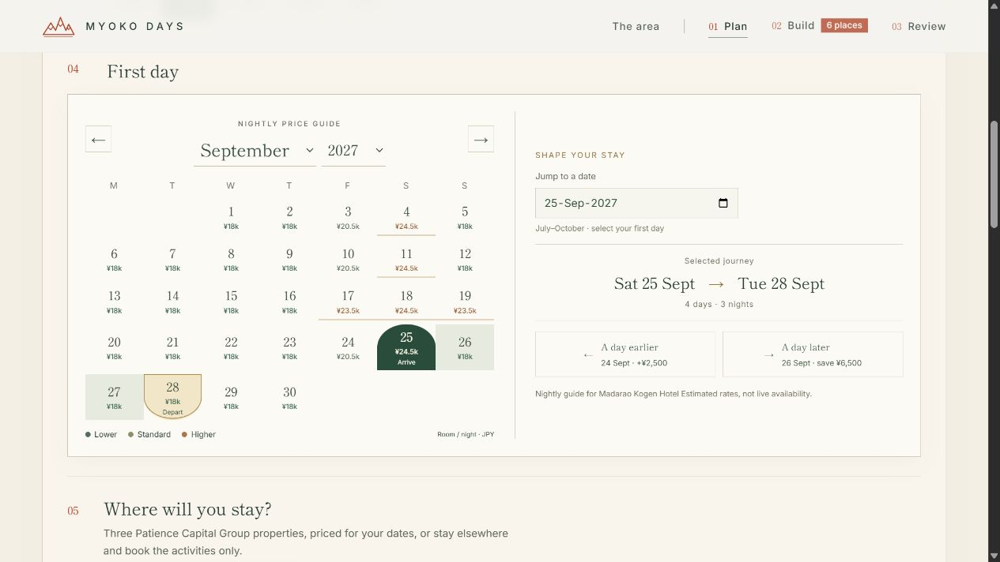

Plan explains Friday/Saturday, holiday and seasonal rate differences before date selection. The compact calendar sits beside the selected journey and one-day-earlier/later stay comparisons. Month/year dropdowns, arrows and direct date entry make changes quick. Colours use the same estimated room-night model as the stay quote, rather than live availability. On phones, the two parts stack without horizontal overflow.

- **Manual placement is explicit.** Adding or moving an activity never silently displaces another activity, switches to a different day or grows the trip. A conflict dialog offers free blocks, clearly stated moves/removals, extension where needed, or cancellation.
- **Best Day dragging opts into sorting.** Dropping onto Best Day retains the automatic solver. Starting a sample itinerary also fits that initial selection to the chosen length.
- **Full-day means both blocks.** Full-day outings reserve morning and afternoon, away from arrival/departure travel blocks. Shortening a trip keeps unresolved activities visible for a decision rather than removing them.
- **Map controls stay useful.** Activity close buttons remain at the top right while details scroll. Day numbers retain contrast in active/hover states. Help closes on outside clicks and map interaction.

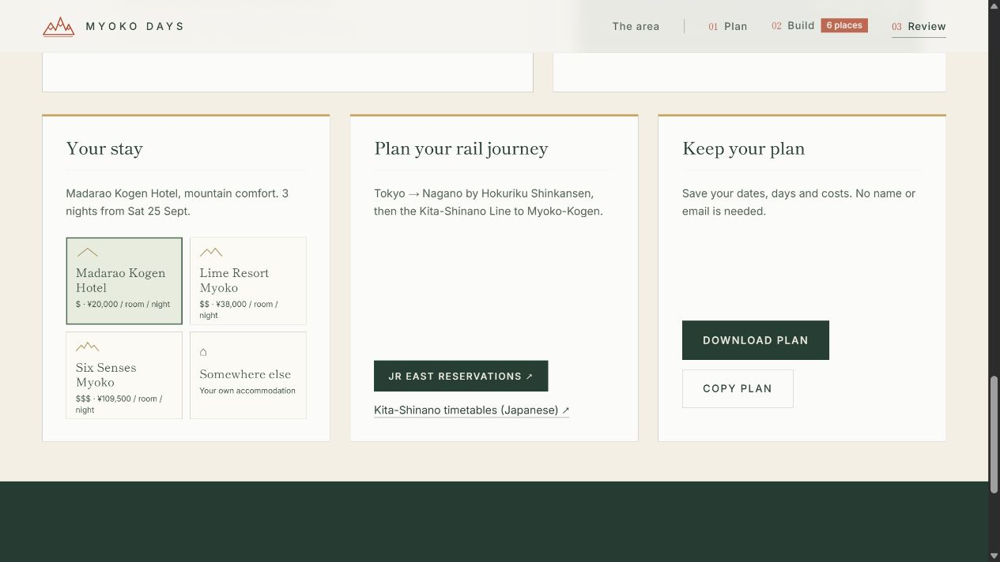

Review shows four compact stay options with mountain tier icons and nightly guide prices. Changing a stay updates costs and routes while preserving the reader's position and the film. Film arrows skip **by activity**, grouping multiple clips from the same place; the day stays visible as context.

## Build: a landscape you can plan inside

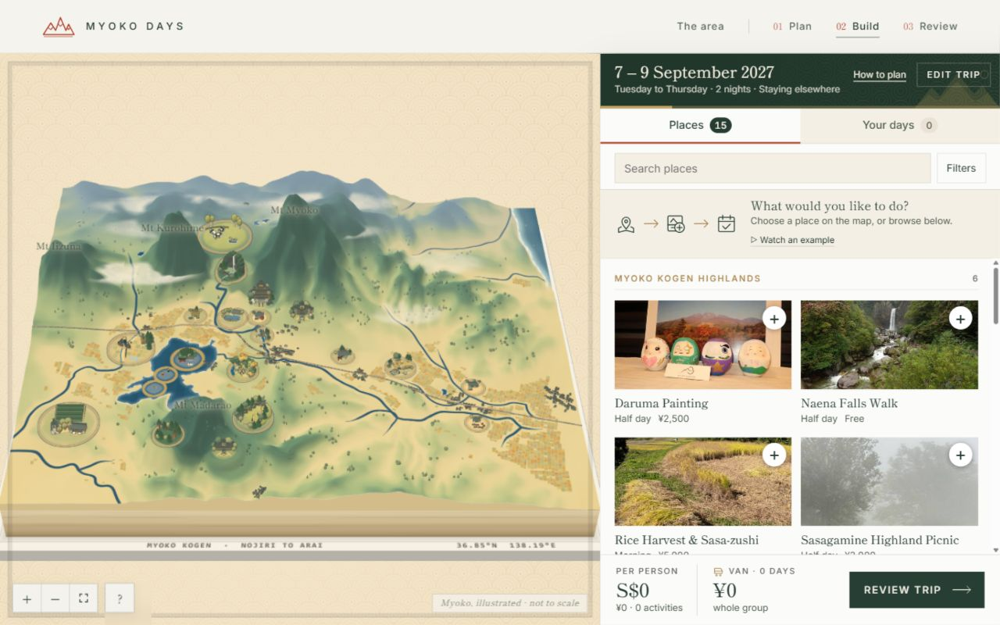

- **Explore the relief.** Pan and zoom through Myoko, Kurohime, Madarao and Iizuna, Lake Nojiri, the highlands and the valley toward Arai. Return to the full composition with the overview control.
- **Open places directly.** Attraction models are selectable. Type filters and the Places list offer another route to the same content; extra nearby ideas can be shown separately.
- **Understand a place before adding it.** Activity information connects location, season, effort, duration, planning price and fieldwork photographs or clips where available.
- **Arrange the trip.** Add a place to a selected day, move activities with explicit conflict choices, inspect days and costs, and continue to Review. The day dock keeps the emerging plan close to the map.
- **Notice the small things.** Farms, roofs, railway details, forest clusters, water strokes, mist and residents make the region feel inhabited without requiring another click.

The map is **geographically adapted and deliberately stylised**. Landmarks have room to read, models are enlarged relative to the landscape, and some placements are adjusted for composition and selection. It is not a navigation or hiking-safety map.

## A painted landscape, built in layers

### Relief that carries the composition

Height images are decoded into terrain; bilinear height sampling also seats models and supports resident movement. A separate layout describes peaks, lakes, rivers, settlements, transport and attraction placements. The camera holds a consistent oblique view so ridges, miniature roofs and activity silhouettes remain legible.

The palette progresses from **ochre plains through yellow-green foothills to deep cedar mountains**. Ridge information, broad light and restrained downhill strokes clarify the landform. This is a painterly interpretation of relief, not a photorealistic satellite surface.

The stored map incorporates geographic adaptation around Lake Nojiri. The current heightfield and layout are the implemented source of truth; earlier terrain-export provenance is incomplete, so this repository does not claim a single verified upstream DEM provider for every inherited asset.

### Water in the same painting

Lake Nojiri, rivers and the sea share a teal–indigo family, lighter shallows and fine pale edges. River masks in the terrain shading help tributaries meet the land without looking like separate plastic strips. Finite, soft sea strokes add movement without hard repeating bands. Water detail stays quiet so activity miniatures remain easy to find.

### Fields, woodland and settlement

The agricultural landscape uses generated plots, levees and colour variation rather than one repeated rectangle. The current verification fixture contains **2,005 rice plots and 209 village houses**. Actual plot footprints also enter resident collision checks: decoration and behaviour share the same map geometry.

Conifers have pointed silhouettes; broadleaf trees have rounded crowns. Groves cluster around woodland and avoid water and activity clearings. Instanced forest geometry keeps large groups economical to draw; zoom-dependent detail lets the overview remain a soft wash instead of a dense field of dots. Houses sit against the relief with muted roofs and timber tones.

### Atmosphere gives the world depth

Distant surfaces shift toward pale blue-grey and warm paper. Terrain, forest and residents use shared aerial-perspective colours and live camera-distance information. Soft mist bands connect the layers. The white fox receives the same depth treatment; the charcoal horse has an additional restrained meadow veil and fading shadow so its dark coat blends into the background. That extra veil clears smoothly on approach.

## Eighteen activity miniatures, fifteen things to do

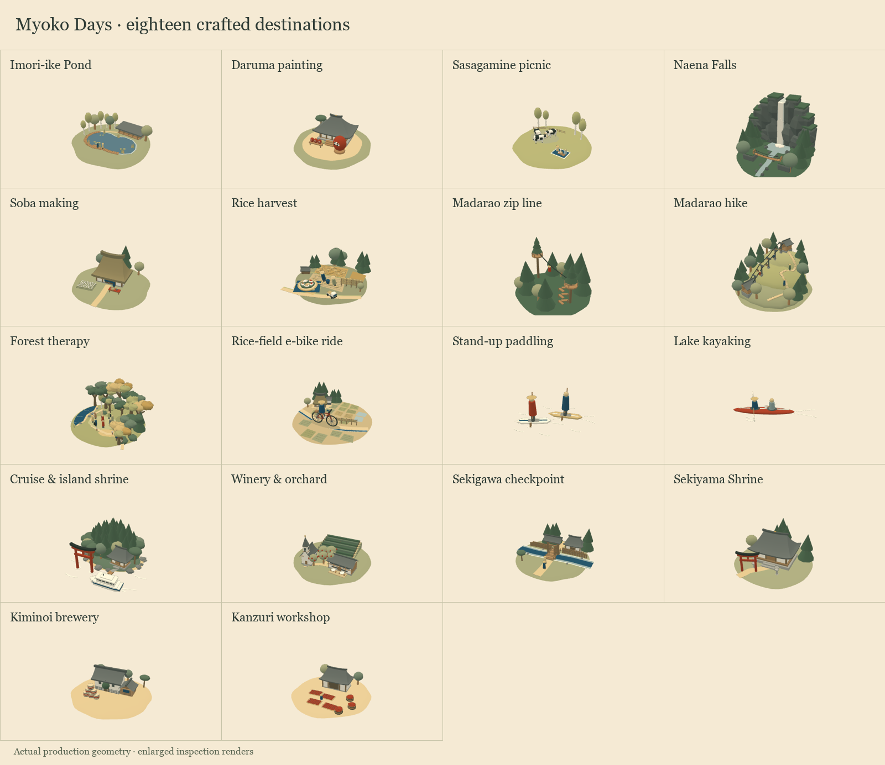

The **15 main activities** have distinct models. The Local Culture Tour has four stops, giving **18 activity miniatures** in total. Three accommodation models and the train extend the same visual vocabulary. They are assembled in code from shaped geometry: roof forms, bevelled walls, torii, trees, paths, boats, figures, fences and cables.

| Activity | What its miniature communicates |
| --- | --- |
| Visitor Center & Imori-ike Pond | An irregular pond, timber boardwalk, reeds, lily pads, birches and a low visitor centre. |
| Daruma Painting | A temple hall and gravel court, with a red daruma and painting-table details. |
| Sasagamine Highland Picnic | A high meadow, cattle, fencing and birch trees: an open landscape rather than another building pin. |
| Naena Falls Walk | A tall white cascade, dark cliff, plunge pool and suspension bridge; animated water gives the vertical feature life. |
| Soba Making | A workshop setting that makes a hands-on food experience distinct from outdoor excursions. |
| Rice Harvest & Sasa-zushi | Rice plots, working figures and drying structures in their agricultural setting. |
| Madarao Forest Zip Line | Tree platforms, cable lines and riders with a readable silhouette across the forest. |
| Mt Madarao Hike via Tangram Chairlift | Lift stations, pylons, suspended chairs, a rising meadow and zigzag summit path. |
| Forest Therapy Walk | A lakeside clearing, broadleaf trees, trail details and walkers gathered at a gentler scale. |
| E-Bike Through the Rice Fields | Terraced paddies, levees, irrigation, a farm lane, farmhouse, drying rack and a small rider. |
| Stand-Up Paddling | A board, standing rider and ripples on the lake, rather than a land-based badge. |
| Kayaking | A narrow red hull, paired paddlers, paddles and wake strokes. |
| Lake Cruise & Island Shrine | Biwajima's wooded island, shoreline, shrine, water-side torii and sightseeing boat. |
| St Cousair Winery & Orchard | Vine and orchard patterns, buildings and chapel forms that distinguish a cultivated estate. |
| Local Culture Tour | Four linked places: Sekigawa's checkpoint and bridge; Sekiyama Shrine; Kiminoi's kura, cedar ball and barrels; Kanzuri's chilli mats, tubs and workshop. |

Accommodation follows the same approach: **Madarao Kogen Hotel**, **Lime Resort Myoko** and the conceptual **Six Senses Myoko** model each have their own massing and landscape details. The Six Senses appearance and operation are prototype assumptions, not a claim about a finished or currently bookable property. See [ASSUMPTIONS.md](ASSUMPTIONS.md).

## Four mountain residents

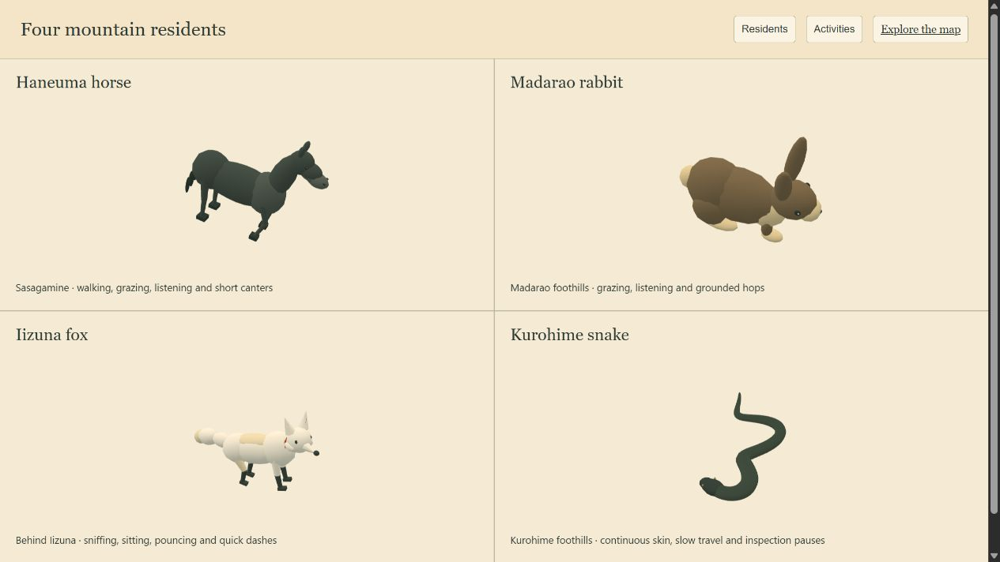

*Enlarged inspection renders of the actual model geometry. In the landscape they are small discoveries, with terrain contact, lighting and haze, rather than oversized mascots.*

| Resident | Habitat and modelling | Movement and character |
| --- | --- | --- |
| **Haneuma horse** | A charcoal horse in a bounded Sasagamine meadow. Separate chest, rump, muzzle and jaw; articulated neck, ears, tail chain and four jointed legs. | Walking, settling, ground-aware grazing and chewing, listening, short eased canters and rests. Terrain-aware leg placement helps feet meet slopes. |
| **Madarao rabbit** | A grey-brown rabbit below Madarao, with rounded haunches, cream tail, separate feet, articulated head and long ears. | Grazing and listening alternate with hop groups. Each hop has a crouch, airborne arc, landing compression and planted pause; forward motion occurs in the airborne part. |
| **Iizuna fox** | A pale fox behind Iizuna, with pointed ears, a long segmented tail and articulated limbs. Landscape haze softens its background silhouette. | Sniffing, sitting, attentive looks, pounces, small hops and brief dashes punctuate local roaming. |
| **Kurohime snake** | A charcoal snake restricted to Kurohime's foothills. One connected, tapered skin replaces disconnected bead-like segments; its head is gently flattened. | Body sections follow the same route by distance, producing continuous travel. Slow movement alternates with inspection and rest. |

All four remain spawned at every zoom. Reduced-motion preferences retain still poses. They do not steal pointer input from activities.

Movement is designed around **habitat and pauses**, rather than constant random motion. The snake's whole body is checked against actual rice plots, house clearances, water and foothill boundaries. Horse and rabbit circuits validate their full footprints against obstacles and slope; grazing poses include ground-clearance checks so muzzles reach grass without sinking into an uphill patch. Canters accelerate and settle rather than switching instantly between speeds. The rabbit stays planted between hops.

### Cultural interpretation, with boundaries

**Haneuma** refers to the horse-shaped spring snow/rock pattern on **Kannasan**, an outer-rim mountain of Myoko. The animated horse near Sasagamine is an artistic response to that association, not a claim about a resident horse spirit or snow persisting through summer. [Myoko City's account](https://www.city.myoko.niigata.jp/docs/3186.html).

The rabbit draws on rural imagery associated with **Furusato** and the Madarao foothills; its placement is art-directed rather than an asserted rabbit-guardian legend. [Nakano City reference](https://www.city.nakano.nagano.jp/docs/2021121300037/file_contents/gaiyou.pdf). The fox and snake are landscape characters, not verified wildlife sightings or proof of a specific local tradition.

## Why it looks this way

- **A journey, not a catalogue.** The oblique landscape helps visitors understand neighbouring experiences before committing them to days. The day dock connects exploration to a practical plan.
- **Warm paper and mineral colours.** The art direction takes cues from Taishō-style bird's-eye travel illustration: washi-like warmth, ochre land, olive greens, ink-like shadows and teal water. It is a contemporary interpretation, not a claimed historical reproduction.
- **Red is an accent with a job.** Vermilion appears on recognisable details such as daruma, kayak, shrine elements and chillies. Restraint helps these details read without making the region a set of warning pins.
- **Silhouettes before tiny realism.** A waterfall should read as a waterfall and a chairlift as a chairlift before someone zooms in. Enlarged landmarks, simple massing and consistent roof forms make this possible.
- **One material family.** Buildings, trees, animals and terrain use a common palette. Soft toon lighting and selective ink outlines make miniature architecture feel crafted; aerial perspective prevents distant details becoming equally loud.
- **Motion that leaves room to look.** Water, steam and residents add life with pauses and short gestures. Reduced-motion support preserves the composition without requiring animation.
- **A green-season story.** Rice, lakes, forest, local food and cultural places share attention with the mountains. The concept expands beyond a ski-only image; it does not claim measured sustainability outcomes from the prototype.

## How the map is built

```text
layout + relief / tone / water / cover images
                  ↓
        terrain and world coordinates
                  ↓
 terrain → water → fields → forest → atmosphere
                  +
       model kit → attraction miniatures
                  +
       terrain-aware resident behaviours
                  ↓
      map selection ↔ itinerary workspace
```

The renderer is **vendored three.js r128**, with plain HTML, CSS and JavaScript around it. There is no framework build step or runtime package installation. Style modules can be applied independently; shared uniforms connect camera, time, palette and atmosphere. Attraction geometry is consolidated for rendering while parts marked to animate remain separate. The forest uses instancing; quality selection and delayed detail reduce unnecessary work at overview scale.

| Area | Main source |
| --- | --- |
| Views and saved trip | `index.html`, `css/`, `js/app.js` |
| Activities and geographic metadata | `js/data.js` |
| Planning, accommodation and assumptions | `js/planner.js`, `js/stay.js`, `js/assumptions.js` |
| Map interface and trip workspace | `js/map.js`, `js/studio.js` |
| Scene, camera and shared atmosphere | `assets/diorama/kit/scene.js` |
| Model primitives, palette and finishing | `assets/diorama/kit/kit.js` |
| Activity, accommodation and train models | `assets/diorama/kit/attractions/` |
| Terrain, water, fields, forest and mist | `assets/diorama/style/` |
| Heightfields, masks and layout | `assets/diorama/data/` |
| Fox and snake behaviours | `assets/diorama/kit/critters.js` |
| Horse and rabbit behaviours | `assets/diorama/kit/grazers.js` |
| Photographs, galleries and films | `js/media*.js`, `js/focus*.js`, `assets/clips/`, `assets/video/` |

## Run and inspect

Python 3.10 or newer is sufficient:

```sh
python preview.py --port 8792
```

Open **http://127.0.0.1:8792/**. Build is at **/#build**. The preview server supports MP4 byte ranges for film seeking. Serve over HTTP rather than opening index.html directly. A WebGL-capable browser is needed for 3D; the Places list provides another way to access activities.

Inspection pages:

- **/tools/showcase.html** — four residents and eighteen activity miniatures, using production geometry.
- **/tools/map-render.html** — a full-width render of the production landscape.
- **/verification/residents.html** — horse and rabbit movement on sampled terrain.
- **/verification/critter-review.html** — a close view of the continuous snake model.

## Verification and honest limits

The website needs no npm packages. Optional checks use Node.js and `pngjs`:

```sh
npm install
npm test
```

Checks cover **20 planner assertions and 400 random trips**, plus explicit-conflict handling, full-day reservations, quote consistency and **250 random manual-placement itineraries**; **18,000 irregular frames** for snake/fox persistence, terrain contact and route safety; and **24,000 frames / 1,512 simulated seconds** for horse/rabbit states, footprint clearance, grazing, planted pauses, continuity and haze material isolation. Browser review covers the integrated map and production-model renders. These are targeted checks, not a complete security or real-device/cross-browser audit.

Material limits remain: some prices, host and operating details are modelled rather than live quotes; a failed initial map prefetch can impede retry; and malformed saved-state identifiers need stricter own-key validation. Historical fieldwork media does not establish current availability. [ASSUMPTIONS.md](ASSUMPTIONS.md) retains modelled inputs and confirmation needs.

## Sharing, source and releases

The website is published at **https://keanedt.github.io/myoko-days/** through GitHub Pages, directly from the main branch. The repository, its history and release downloads are public at the owner's request. Visitors can inspect the delivered HTML, JavaScript and assets. Never put secrets in client files.

The site includes robots.txt and a noindex meta directive to ask search engines not to index it. These are voluntary crawler hints, not access controls. No invitations or social announcements are sent by this project; GitHub may still display public repository activity to followers.

The **Mountain Residents** release packages the complete website and preview server. Its release page showcases Haneuma horse, Madarao rabbit, Iizuna fox and Kurohime snake alongside the map. Download, extract and run the server above.

### Dependencies and media

three.js r128 is distributed under the MIT licence; its vendored licence header is retained. [three.js licence](https://github.com/mrdoob/three.js/blob/r128/LICENSE). `pngjs` is an optional development-only dependency under MIT. [pngjs licence](https://github.com/pngjs/pngjs/blob/main/LICENSE).

Project photographs, films, illustrations and original code are retained for this project. No general public reuse licence is granted. A viewable experience does not grant redistribution rights to its media.


## Refined trip planning

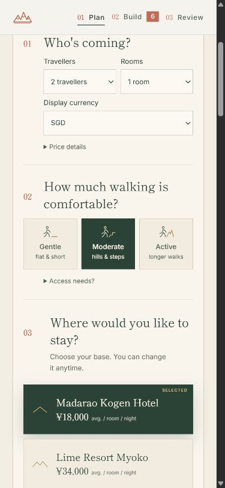

Plan now asks for traveller and room counts, walking comfort, accommodation preference, and arrival/departure dates. Days and nights are derived from the range (3–7 days, July–October); dates that create scheduling or seasonal issues require confirmation and preserve every activity. Hotel changes preserve dates and placements. Independently booked accommodation is excluded from the total. Rooms assume up to two guests, and traveller prices use adult fares.

Restore, Discover and Move offer starting itineraries matched to the visitor’s settings. Build my own plan opens the map while preserving existing selections. Display currency supports JPY, SGD, USD, EUR, GBP, AUD and HKD via [Frankfurter](https://frankfurter.dev/); conversions are dated reference values with cached/offline handling. All source prices remain JPY. Preferences and rates stay in browser storage; no account is required.

This remains a planning prototype. It does not reserve inventory or process payments. Reviewed translations, child-specific fares, detailed transport connections and integrated reservations remain future work. Low walking effort is not a wheelchair-accessibility guarantee.

Visual refinement: consistent hotel/calendar margins, restrained terrain icons, capitalised secondary labels and shorter copy. The redundant quick-plan row, temporary disclosures and map-introduction strip are removed. Three small planning symbols live above How to plan in the aligned dock header. Decide later has been removed; old undecided saves migrate to independently booked accommodation without introducing a stay charge.


### A quieter Build workspace

Map-tooltip additions and the Places add buttons open the day/block chooser directly. All places is a working return control with accessible pointer and keyboard input. Distinct, natural-height day cards use one subdued note for travel, open time, full-day outings, transfers and walking/season cautions. Review represents unplanned blocks with light rules and gives all accommodation options the same icon/name/price alignment. Notifications are compact and sit close to the dock footer.

The example cursor travels through coordinates measured from its actual controls, with visible selection and confirmation feedback. Pause/resume, step controls, reduced motion and trip isolation remain supported. Reference notes and duplicate instructions are absent from the visitor interface; detailed modelling information remains in ASSUMPTIONS.md.


### Reliable content visibility

Itinerary cards, local profiles and editorial sections are visible by default. Scroll animation only adds a subtle entrance; it never gates access to content. Completing a background exchange-rate request updates converted price text without reconstructing the home page. A regression check protects card/profile identity during these asynchronous updates.

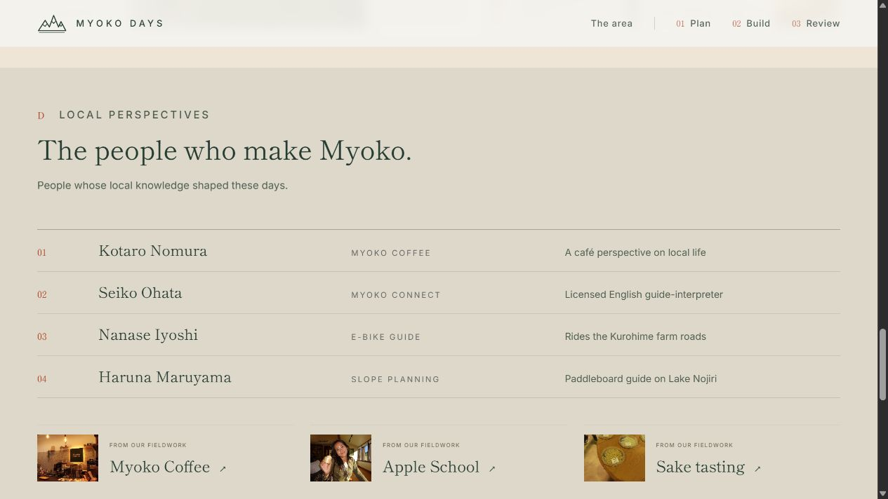
