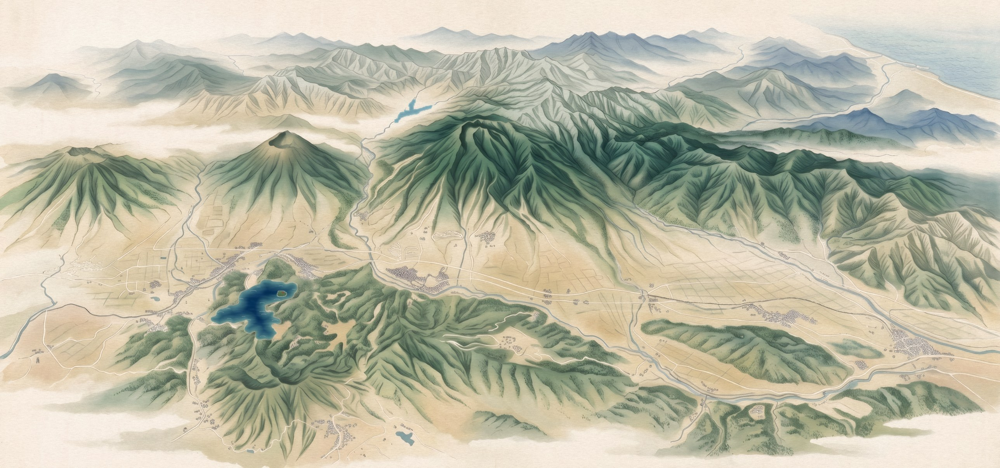
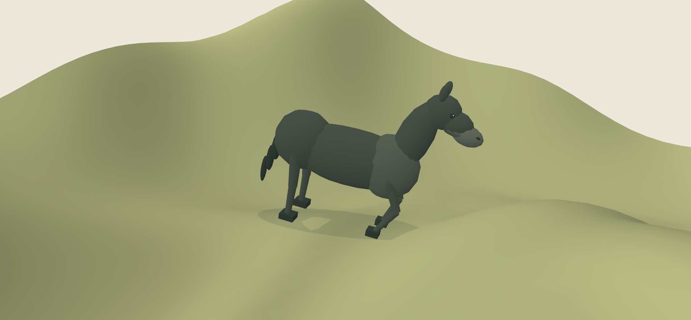
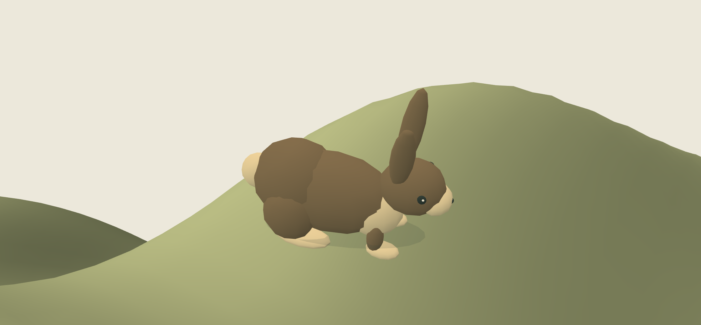

# Myoko Days

### Make room for Myoko.

A green-season itinerary builder for the Myoko area, created for the SMU sustainability communication project with Patience Capital Group. Explore an illustrated 3D mountain diorama, choose places, arrange your days and keep a written plan and trip film.

**Private project · static website · no account or backend required**



## Explore

- **Plan:** choose dates, party, walking preference and stay. Begin with Restore, Discover, Move or an empty map.
- **Build:** explore the terrain, open activities, add places and rearrange morning/afternoon blocks.
- **Review:** see your days, planning costs, fieldwork film and downloadable written plan.
- **Discover the residents:** a white fox behind Iizuna, a charcoal snake at Kurohime's foot, a Haneuma-inspired horse near Sasagamine and a rabbit below Madarao.

## The new residents

| Haneuma horse | Madarao rabbit |
| --- | --- |
|  |  |
| Slow walking, grazing, attentive pauses and brief canters. | Grazing, listening and short groups of crouch–hop–land movements. |

These are renders of the production meshes. The review camera enlarges them for inspection; they remain small details in the map. Residents stay spawned at every zoom. Reduced-motion users see still poses. The snake avoids generated rice plots and village houses. New circuits validate full-body clearances against water, fields, houses, attraction pads and slopes.

## Run locally

Python 3.10 or newer is sufficient. There is no build or runtime dependency installation.

```sh
python preview.py --port 8792
```

Open **http://127.0.0.1:8792/**. Stop with Ctrl+C. The included server supports MP4 byte ranges for seeking. Serve the folder over HTTP rather than opening index.html directly. The map requires WebGL2; the Places list provides activity access when the map is unavailable.

Open **/verification/residents.html** on the same server for a close-up model review. The full site starts at **/#home** or **/#build**.

## Architecture

| Area | Files |
| --- | --- |
| Main views and saved trip | `index.html`, `css/`, `js/app.js` |
| Planning and costs | `js/planner.js`, `js/stay.js`, `js/assumptions.js` |
| Map interface | `js/map.js`, `js/studio.js` |
| Terrain and rendering | `assets/diorama/kit/scene.js`, `kit.js`, `style/` |
| Fox and snake | `assets/diorama/kit/critters.js` |
| Horse and rabbit | `assets/diorama/kit/grazers.js` |
| Fieldwork galleries and films | `js/media*.js`, `js/focus*.js`, `assets/clips/`, `assets/video/` |
| Terrain and placements | `assets/diorama/data/` |

The website uses plain HTML/CSS/JavaScript and vendored three.js r128. Trip state stays in this browser's localStorage. The site makes no reservations, takes no payments and sends no enquiries.

## Verification

The app needs no npm packages. Optional development tests use Node.js and pngjs:

```sh
npm install
npm test
```

- Planner: 20 checks, including 400 random trips.
- Snake/fox: 18,000 irregular frames; visibility, full-body clearances, terrain contact and closed skin topology.
- Horse/rabbit: 24,000 frames, about 25 minutes; every grazing, travel, canter, listening and hop state; habitat checks, planted rests and route wrap.
- Browser review: production-model close-ups and the integrated map. Results are in `verification/*results.json`.

These are targeted checks, not a complete security, cross-browser, device or real-world trip-feasibility audit.

## Cultural and geographic interpretation

The horse draws on **Haneuma**, the spring horse-shaped snow/rock pattern on Kannasan, an outer-rim mountain of Myoko. Its animated form and placement near Sasagamine are an artistic interpretation, not a claim about a resident horse spirit or snow present throughout summer. [Myoko City source](https://www.city.myoko.niigata.jp/docs/3186.html).

The rabbit draws on the rural imagery associated with **Furusato** and the Madarao foothills. Its position is art-directed; it is not presented as an established rabbit-guardian legend. [Nakano City source](https://www.city.nakano.nagano.jp/docs/2021121300037/file_contents/gaiyou.pdf).

The map is a stylised, geographically adapted diorama rather than a navigation map. See [the animation plan](docs/ANIMAL_PLAN.md) and [earlier research](ANIMATION_OPTIONS.md).

## Known limitations

Costs and some operational details are modelled, not live operator quotes. The current planner can combine a long outing with another half-day activity. Map-load retry handling and malformed saved-state validation need further work. Read **[CODE_REVIEW.md](CODE_REVIEW.md)** before treating this prototype as an operational travel service. Historical fieldwork footage does not establish current availability.

## Releases and privacy

The release ZIP contains the complete site and local preview server. This repository and its releases are private. Fieldwork media is retained for the owner's project use; no general public reuse licence is granted. See [THIRD_PARTY.md](THIRD_PARTY.md) for dependency and media notes.
